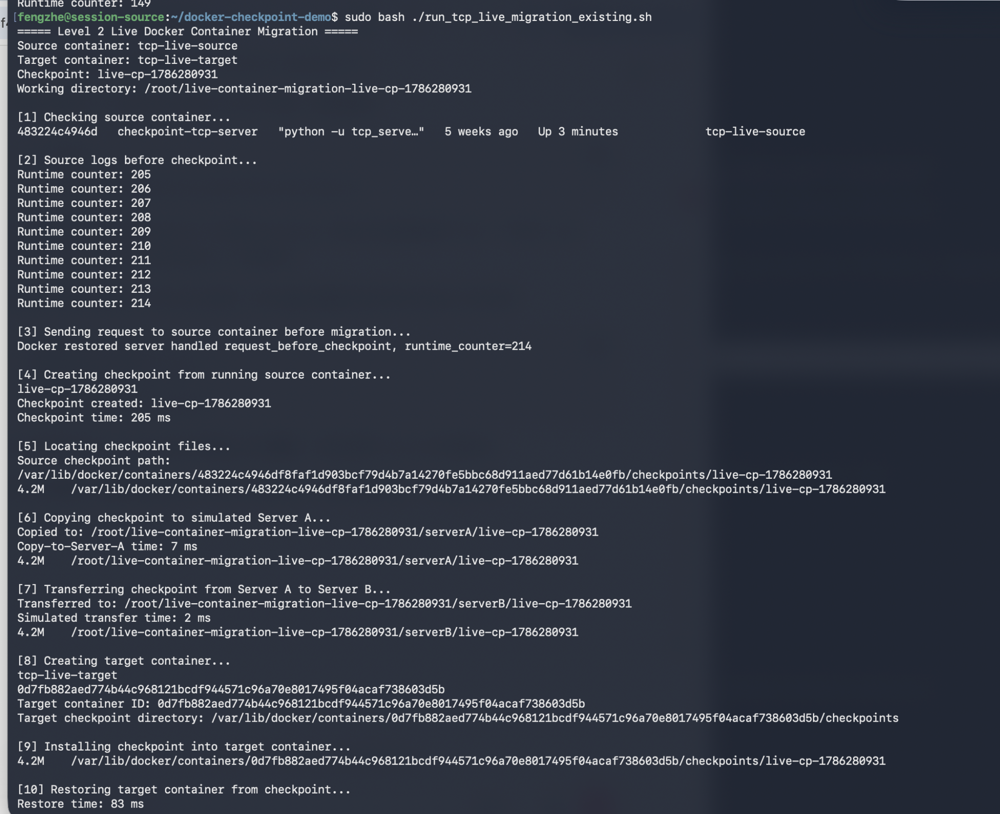
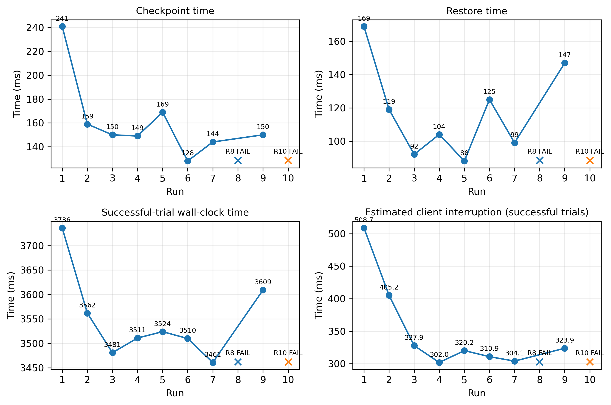
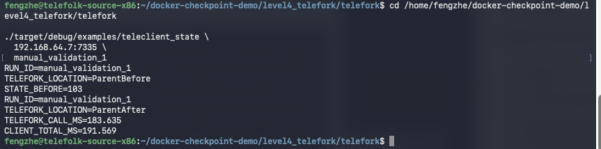
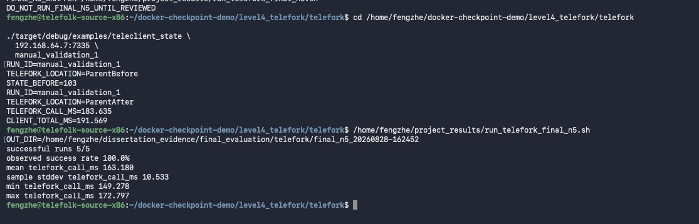
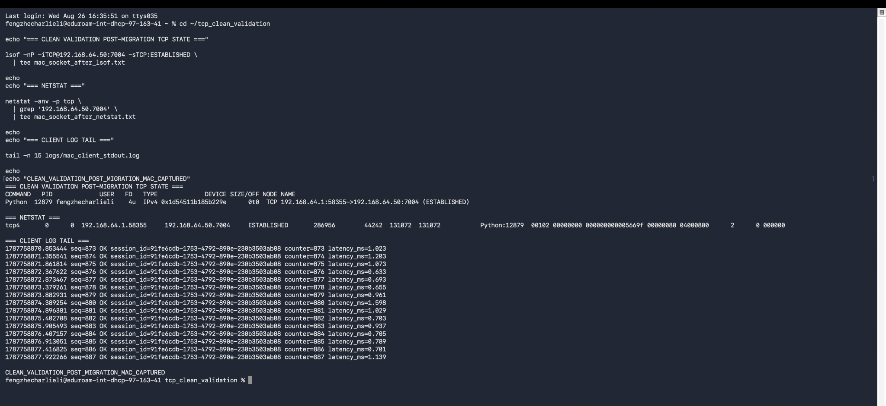

# Cross-Machine Session Migration

This repository contains the implementation artefacts and curated experimental evidence for an MSc dissertation project on cross-machine session migration. The project studies how a running computation can move from one machine to another while preserving state and, where possible, hiding the movement from the client.


## Research Question

> To what extent can a running service session be migrated across machines while preserving computation state and client-visible continuity?

The project separates two related goals:

- **Computation migration:** preserving application state, container runtime state, or native process state.
- **Communication continuity:** keeping the client attached to a stable endpoint, and in the strongest experiment preserving an already-established TCP session.

## Migration Levels

| Level / mechanism | Main idea | Final evidence summary |
|---|---|---:|
| Level 1 application migration | Application explicitly saves and restores state | Representative state-continuity demonstration |
| Level 2 Docker/CRIU | Docker checkpoint/restore moves a stateful TCP container | 8/10 final trials |
| Level 3 native CRIU | CRIU migrates a Linux process outside Docker | 5/5 final trials |
| Telefork | Telefork migrates process state to a compatible target | 5/5 strict validation |
| Established TCP + VIP | CRIU TCP restore plus floating VIP preserves an active session | 5/5 final trials |

## Repository Structure

```text
.
├── level1-application-state/        # application-aware state transfer warm-up
├── level2-docker-criu/              # Docker checkpoint/restore using CRIU
├── level3-native-criu/              # native CRIU process migration
├── telefork/                        # Telefork process migration investigation
├── established-tcp-vip/             # CRIU TCP-established migration with floating VIP
├── experiments/                     # proxy continuity and same-machine TCP validation
└── docs/
    ├── EXPERIMENT_EVIDENCE.md       # evidence overview
    ├── FIGURE_INDEX.md              # full figure index
    ├── evidence/                    # detailed per-mechanism evidence galleries
    └── figures/                     # curated screenshots, plots, and diagrams
```

Large generated artefacts are intentionally excluded: CRIU image files, VM images, Docker image archives, raw logs, caches, keys, and local environment files.

## Level 1: Application-Managed Migration

The Level 1 experiment is the warm-up case. The application knows migration is happening and explicitly transfers its own state.


## Level 2: Docker/CRIU Container Migration

The Level 2 experiment migrates a Dockerised stateful TCP service using Docker checkpoint/restore. CRIU is used underneath Docker, but the research object here is the container runtime.







The final Docker evaluation retained all attempts: **8 successful migrations out of 10**. Failed checkpoint attempts are included as real evidence, not removed from the dataset.

## Level 3: Native CRIU Process Migration

The native CRIU experiment removes Docker and migrates a Linux process directly. Counter continuity is used as the observable state-preservation signal.


Final repeated evaluation: **5/5 successful migrations**.

## Telefork

Telefork is evaluated as an alternative process-migration mechanism. The strict validation requires source-side state, target-side child execution, and state continuation evidence.






Final strict validation: **5/5 successful runs**.

## Established TCP + Floating VIP

The strongest experiment uses an independent Mac client, a floating VIP, CRIU `--tcp-established`, and network locking. The client connects to `192.168.64.50:7004` and keeps the same session while the server process migrates from source to target.





Final repeated evaluation: **5/5 successful migrations**.

Claim boundary: the repository demonstrates client-visible endpoint continuity, same application session ID, strict counter progress, and TCP four-tuple observations before and after migration. It does not claim packet-level proof of no second SYN unless packet capture evidence is collected separately.

## Key Results

| Mechanism | Final repeated result | Main claim supported |
|---|---:|---|
| Level 2 Docker/CRIU | 8/10 successful migrations | Container runtime state can be migrated, though checkpoint creation can fail under repeated trials. |
| Level 3 Native CRIU | 5/5 successful migrations | Native process state can be checkpointed, transferred, and restored with counter continuity. |
| Telefork | 5/5 strict validation runs | A running process can resume on a target machine with preserved application state. |
| Established TCP + VIP | 5/5 successful migrations | An already-established client session can continue across source-to-target migration in the tested environment. |

## Evidence

The full curated evidence collection is intentionally larger than the README:

- [Experiment evidence overview](docs/EXPERIMENT_EVIDENCE.md)
- [Level 1 evidence](docs/evidence/LEVEL1_EVIDENCE.md)
- [Level 2 Docker/CRIU evidence](docs/evidence/LEVEL2_DOCKER_CRIU_EVIDENCE.md)
- [Native CRIU evidence](docs/evidence/NATIVE_CRIU_EVIDENCE.md)
- [Telefork evidence](docs/evidence/TELEFORK_EVIDENCE.md)
- [Established TCP + VIP evidence](docs/evidence/ESTABLISHED_TCP_VIP_EVIDENCE.md)
- [Full figure index](docs/FIGURE_INDEX.md)

## Notes on Telefork Source

The `telefork/telefork/` directory contains the Telefork implementation used for the dissertation experiments. The dissertation-specific contribution here is the experimental evaluation, instrumentation, and cross-machine evidence around that mechanism, not claiming original authorship of the upstream Telefork idea.
