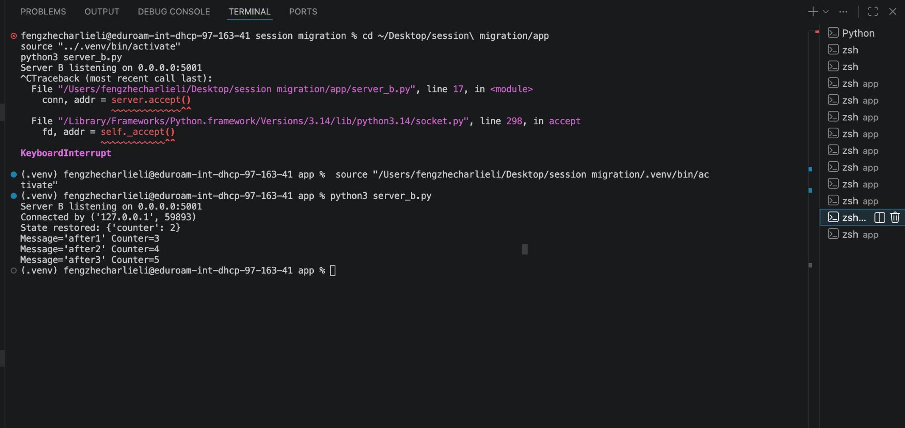
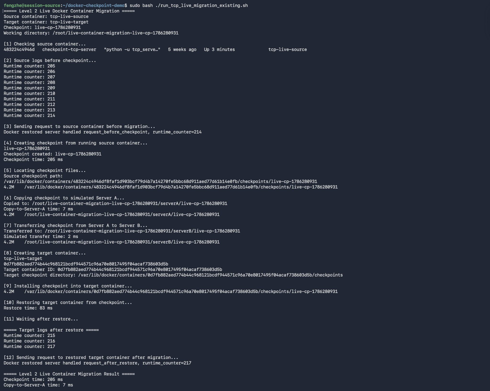
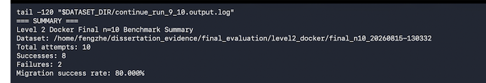
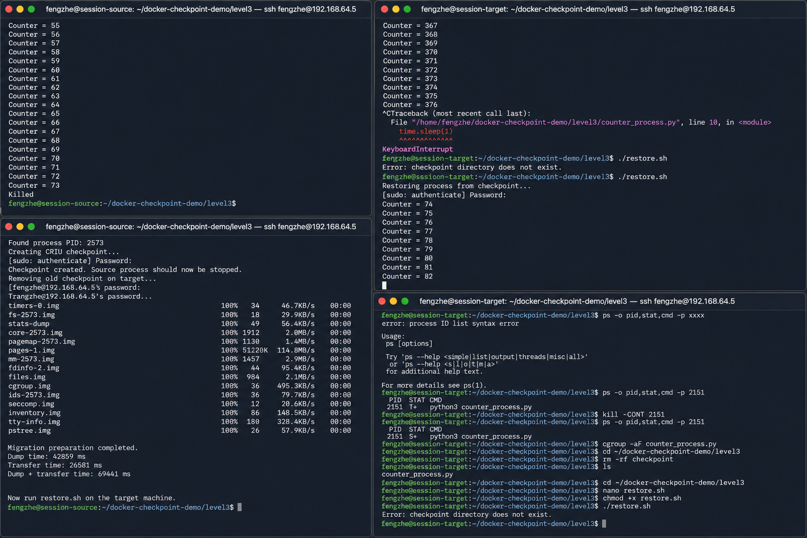
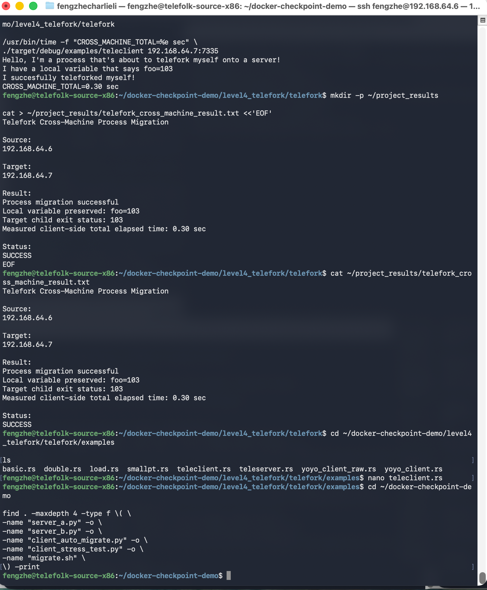
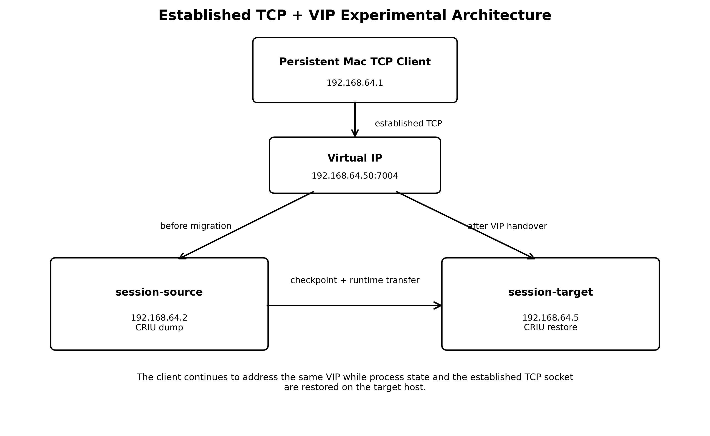
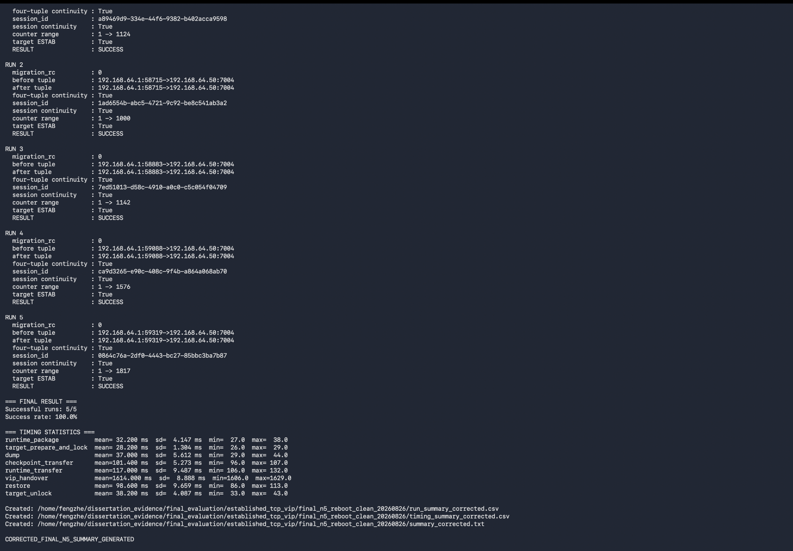

# Cross-Machine Session Migration

This repository contains the implementation artefacts and curated experimental evidence for an MSc dissertation project on cross-machine session migration. The project investigates how computation can be moved from one machine to another while preserving execution state and, where possible, hiding that movement from the client.

The work is organised as a progression of migration difficulty:

1. application-managed state migration;
2. Docker/container checkpoint and restore using CRIU;
3. native process migration using CRIU;
4. Telefork-based cross-machine process migration;
5. established TCP session migration using CRIU, a floating virtual IP, and network locking.

## Research Scope

The central research question is:

> To what extent can a running service session be migrated across machines while preserving computation state and client-visible continuity?

The repository separates two related but different goals:

- **Computation migration:** preserving application state, container runtime state, or native process state.
- **Communication continuity:** keeping the client connected to a stable endpoint, or in the strongest experiment, preserving an already-established TCP session.

## Repository Structure

```text
.
├── level1-application-state/        # application-aware state transfer warm-up
├── level2-docker-criu/              # Docker checkpoint/restore using CRIU
├── level3-native-criu/              # native CRIU process migration
├── telefork/                        # Telefork process migration investigation
├── established-tcp-vip/             # CRIU TCP-established migration with floating VIP
├── experiments/                     # proxy continuity and same-machine TCP validation
└── docs/
    ├── EXPERIMENT_EVIDENCE.md       # detailed evidence narrative
    ├── FIGURE_INDEX.md              # compact figure index
    ├── architecture/                # review and architecture notes
    └── figures/                     # curated dissertation evidence images
```

Large generated artefacts are intentionally excluded: CRIU image files, VM images, Docker image archives, raw logs, caches, keys, and local environment files.

## Migration Levels

### Level 1: Application-Managed Migration

The Level 1 experiment uses an application-aware counter workload. The application explicitly serialises state and restores it on another server instance. This is the warm-up layer: the application knows migration is happening.



This figure shows Server B continuing from transferred application state rather than starting from zero.

### Level 2: Docker/CRIU Container Migration

The Level 2 experiment migrates a Dockerised stateful TCP service using Docker checkpoint/restore with CRIU underneath. The workflow checkpoints the running container, transfers checkpoint state, restores on the target, and uses a stable client-facing endpoint for continuity measurements.



Final repeated evaluation produced **8 successful migrations out of 10 attempts**. Failed attempts are retained as real failures rather than removed from the dataset.



### Level 3: Native CRIU Process Migration

The native CRIU experiment moves a Linux process without Docker. It demonstrates process-level checkpoint, transfer, and restore, with counter continuity used as the observable state-preservation signal.



Final repeated evaluation produced **5 successful migrations out of 5 attempts**.

### Telefork

Telefork was evaluated as an alternative process migration mechanism. The experiment keeps the upstream Telefork implementation intact and uses example programs to migrate a process from source to target while preserving a small runtime state value.



The strict final validation recorded **5 successful runs out of 5**, requiring matching source/target evidence and state continuity.

### Established TCP + Floating VIP

The strongest communication-continuity experiment uses CRIU `--tcp-established`, network locking, runtime dependency packaging, and a floating VIP. An independent Mac client connects to `192.168.64.50:7004` and keeps one TCP session while the server process migrates from `session-source` to `session-target`.



The claim is carefully bounded: the evidence demonstrates client-visible endpoint continuity, same application session ID, strict counter progress, and matching TCP four-tuple observations before and after migration. Packet-level absence of a second SYN is not claimed unless packet capture evidence is separately collected.

Final repeated evaluation produced **5 successful migrations out of 5 attempts**.



## Key Results

| Mechanism | Final repeated result | Main claim supported |
|---|---:|---|
| Level 2 Docker/CRIU | 8/10 successful migrations | Container runtime state can be migrated, but checkpoint creation can fail under repeated trials. |
| Level 3 Native CRIU | 5/5 successful migrations | Native process state can be checkpointed, transferred, and restored with counter continuity. |
| Telefork | 5/5 strict validation runs | A running process can resume on a target machine with preserved application state. |
| Established TCP + VIP | 5/5 successful migrations | An already-established client session can continue across source-to-target migration using CRIU TCP restore and VIP handover. |

More complete evidence, including representative screenshots and repeated-trial figures, is documented in [docs/EXPERIMENT_EVIDENCE.md](docs/EXPERIMENT_EVIDENCE.md). A compact list of all curated figures is available in [docs/FIGURE_INDEX.md](docs/FIGURE_INDEX.md).

## Notes on Telefork Source

The `telefork/telefork/` directory contains the Telefork implementation used for the dissertation experiments. The dissertation-specific contribution here is the experimental evaluation, instrumentation, and cross-machine evidence around that mechanism, not claiming original authorship of the upstream Telefork idea.
