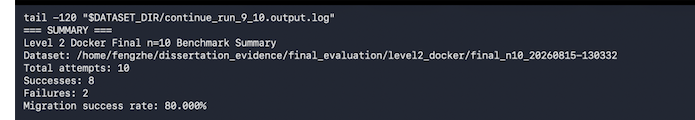
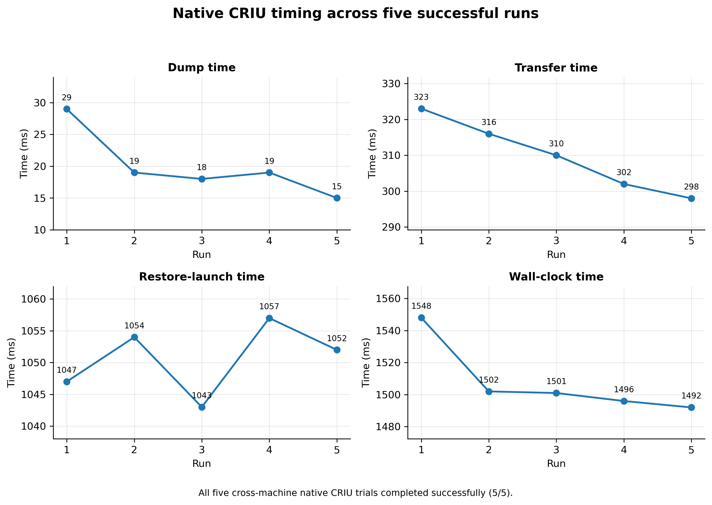
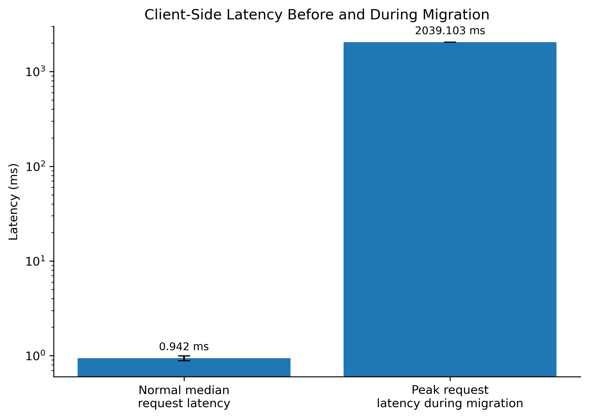

# Experiment Evidence Overview

This page is the high-level index for the repository evidence. Detailed galleries are split by migration mechanism so the README remains readable while the repository still preserves substantial proof that the experiments were executed.

## Detailed Evidence Pages

- [Level 1 application migration](evidence/LEVEL1_EVIDENCE.md)
- [Level 2 Docker/CRIU](evidence/LEVEL2_DOCKER_CRIU_EVIDENCE.md)
- [Native CRIU process migration](evidence/NATIVE_CRIU_EVIDENCE.md)
- [Telefork process migration](evidence/TELEFORK_EVIDENCE.md)
- [Established TCP + VIP](evidence/ESTABLISHED_TCP_VIP_EVIDENCE.md)

## Evidence Counts

- **Level 1 application migration:** 8 files
- **Level 2 Docker/CRIU:** 65 files
- **Native CRIU:** 25 files
- **Telefork:** 30 files
- **Established TCP + VIP:** 87 files

## Representative Summary Figures

### Level 1 application migration

Server B continues using restored application state.

### Level 2 Docker/CRIU

Final Docker repeated evaluation summary.

### Level 2 Docker/CRIU

Docker n=10 timing analysis.

### Native CRIU

Native CRIU final n=5 summary.

### Native CRIU

Native CRIU timing analysis.

### Telefork

Telefork strict final n=5 summary.

### Telefork

Telefork per-run timing.

### Established TCP + VIP

Three-machine established TCP migration architecture.

### Established TCP + VIP

Final established TCP + VIP n=5 summary.

### Established TCP + VIP

Client latency comparison.

