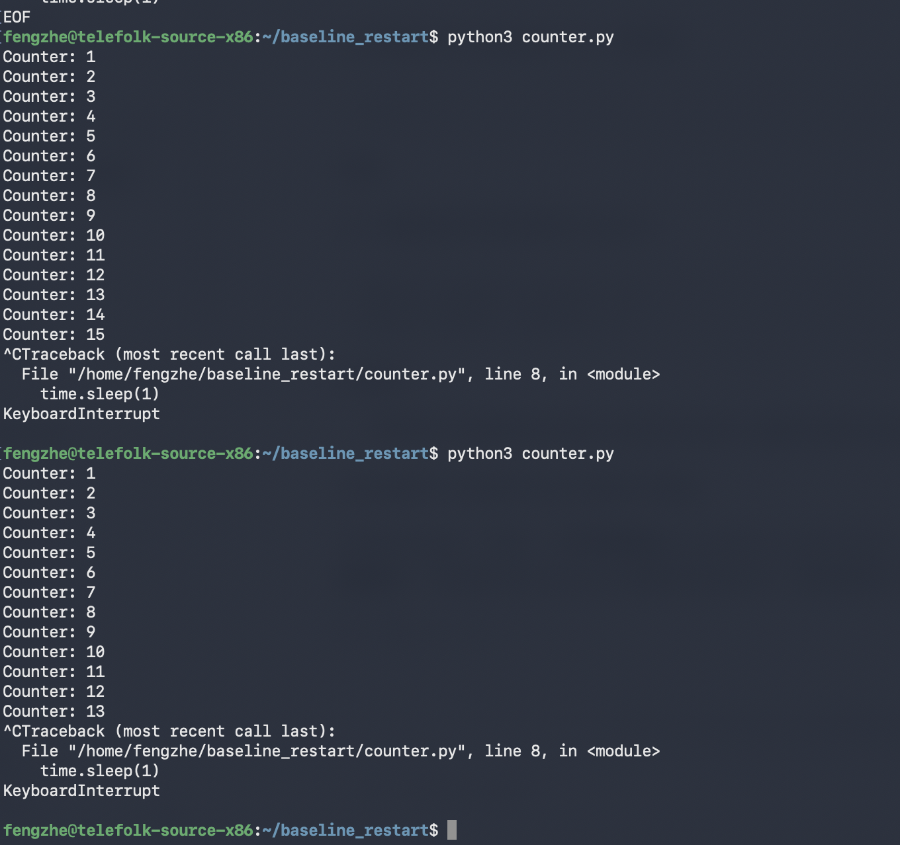
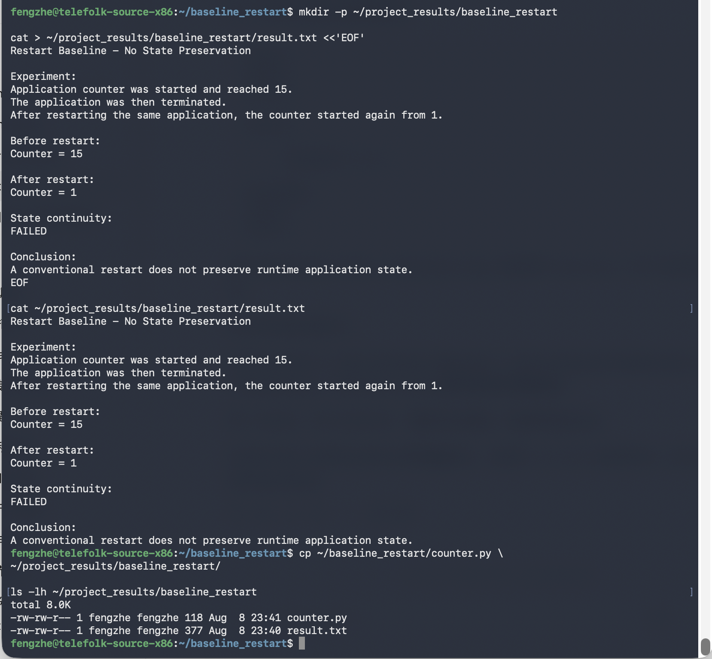
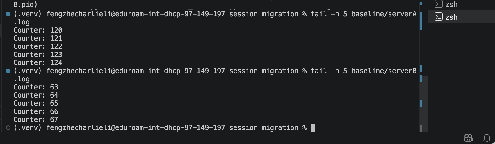
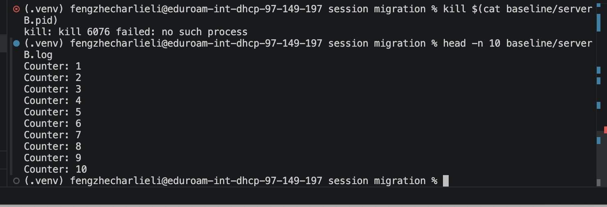
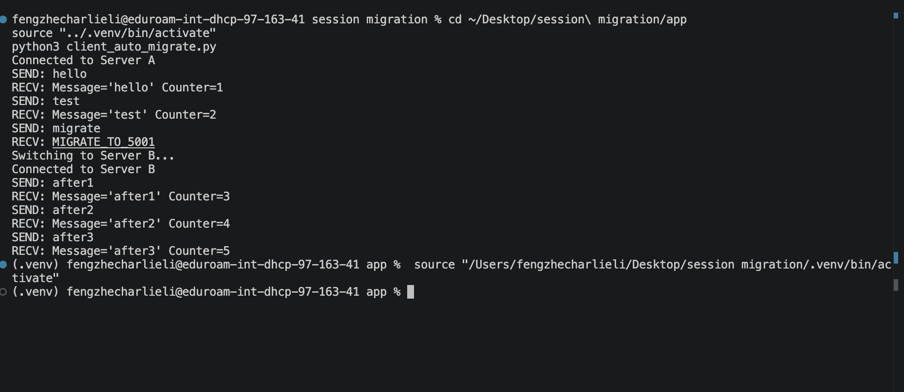
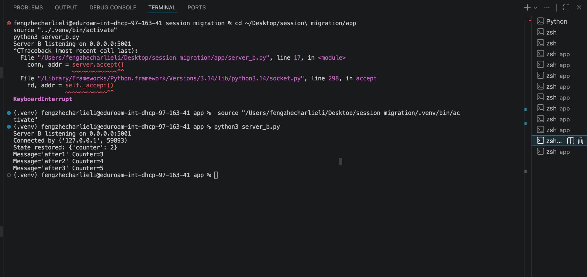

# Level 1 Application-Level Migration Evidence

Level 1 is the application-aware baseline. The application explicitly serialises and transfers state, so it demonstrates computation migration in the warm-up setting where the program participates in the migration protocol.

The evidence below separates the baseline restart case, where state is lost, from the application-managed migration case, where Server B resumes from transferred state.

Total curated evidence files in this section: **8**.

## Evidence Gallery

### Baseline Restart Counter Reset

- **Evidence type:** representative migration evidence
- **What it shows:** baseline restart behaviour and state-loss comparison.
- **Claim supported:** Supports the Level 1 claim that explicit application state transfer can preserve observable state.

### Baseline Restart No State Preservation

- **Evidence type:** representative migration evidence
- **What it shows:** baseline restart behaviour and state-loss comparison.
- **Claim supported:** Supports the Level 1 claim that explicit application state transfer can preserve observable state.

### Baseline Restart State Loss

- **Evidence type:** representative migration evidence
- **What it shows:** baseline restart behaviour and state-loss comparison.
- **Claim supported:** Supports the Level 1 claim that explicit application state transfer can preserve observable state.

### Baseline Serverb Restarts From 1

- **Evidence type:** supporting evidence
- **What it shows:** baseline restart behaviour and state-loss comparison.
- **Claim supported:** Supports the Level 1 claim that explicit application state transfer can preserve observable state.

### Level1

- **Evidence type:** supporting evidence
- **What it shows:** level1.
- **Claim supported:** Supports the Level 1 claim that explicit application state transfer can preserve observable state.

### Level1 2

- **Evidence type:** supporting evidence
- **What it shows:** level1 2.
- **Claim supported:** Supports the Level 1 claim that explicit application state transfer can preserve observable state.

### Level1 Application Aware Migration Client Switch

- **Evidence type:** representative migration evidence
- **What it shows:** application-aware state-transfer flow.
- **Claim supported:** Supports the Level 1 claim that explicit application state transfer can preserve observable state.

### Level1 Server B State Restored

- **Evidence type:** target-side terminal evidence
- **What it shows:** target Server B state restoration after application-managed migration.
- **Claim supported:** Supports the Level 1 claim that explicit application state transfer can preserve observable state.

