# Native CRIU Process Migration Evidence

The native CRIU experiment removes Docker from the stack and migrates a Linux process directly. The main observable state is a counter that should continue after restore on the target machine.

The evidence includes manual validation, cross-machine checkpoint/transfer/restore screenshots, final n=5 summary evidence, raw CSV views, and timing plots.

Total curated evidence files in this section: **25**.

## Evidence Gallery

### Level3 Criu Automated Cross Machine Migration

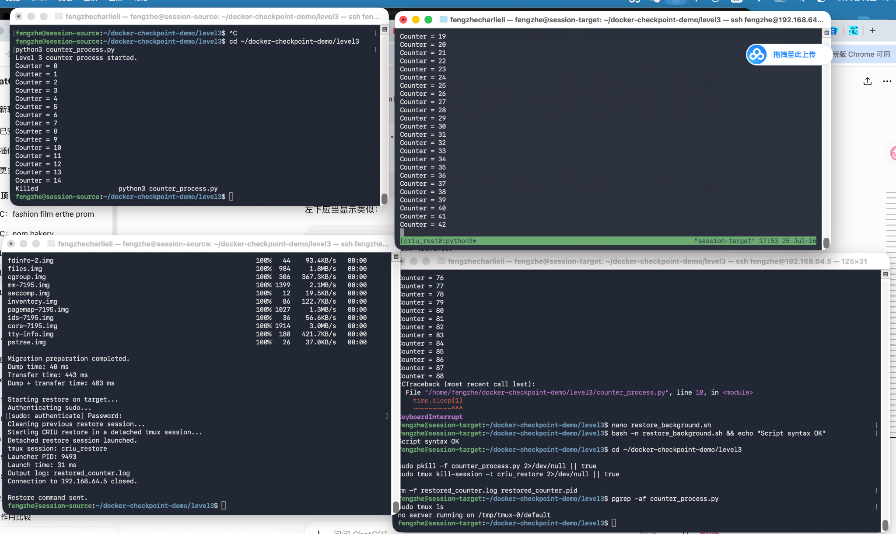

- **Evidence type:** representative migration evidence
- **What it shows:** level3 criu automated cross machine migration.
- **Claim supported:** Supports the Level 3 claim that native CRIU can migrate process state outside Docker.

### Level3 Criu Checkpoint Transfer Restore Continuity

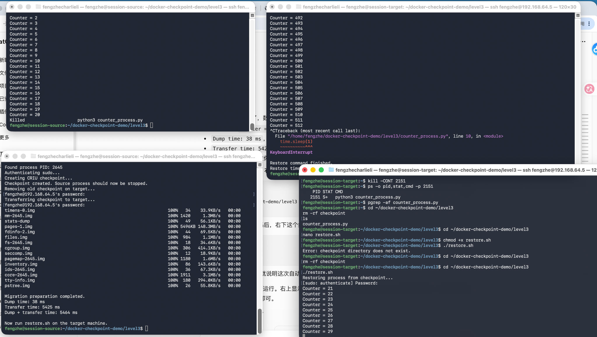

- **Evidence type:** representative migration evidence
- **What it shows:** checkpoint transfer and target restore workflow.
- **Claim supported:** Supports the Level 3 claim that native CRIU can migrate process state outside Docker.

### Level3 Criu Cross Machine Checkpoint Transfer Restore

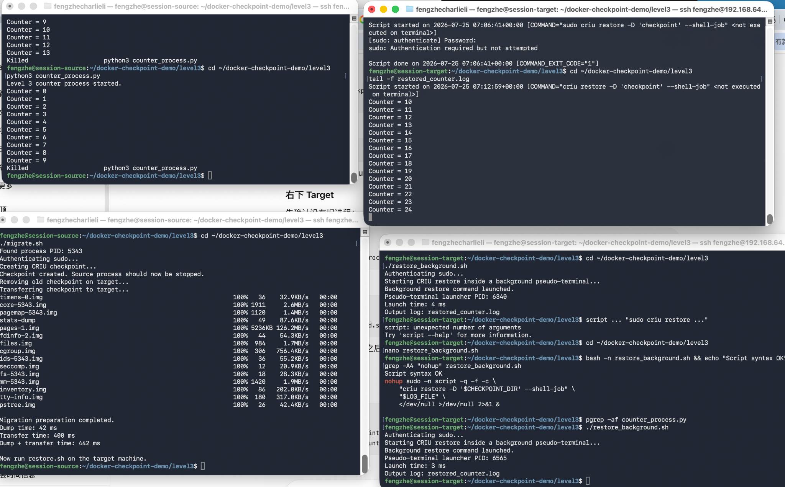

- **Evidence type:** representative migration evidence
- **What it shows:** checkpoint transfer and target restore workflow.
- **Claim supported:** Supports the Level 3 claim that native CRIU can migrate process state outside Docker.

### Level3 Criu Cross Machine Counter Continuity Success

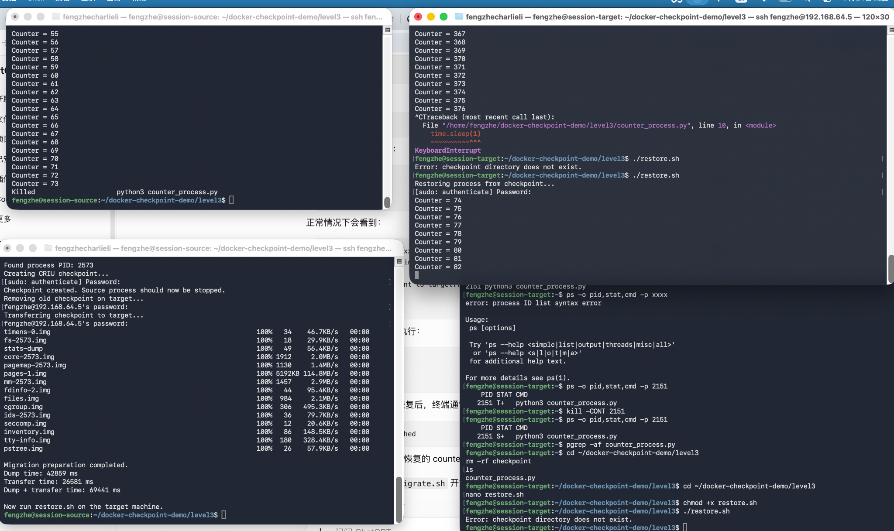

- **Evidence type:** representative migration evidence
- **What it shows:** counter continuity evidence.
- **Claim supported:** Supports the Level 3 claim that native CRIU can migrate process state outside Docker.

### Level3 Criu Cross Machine Migration Workflow

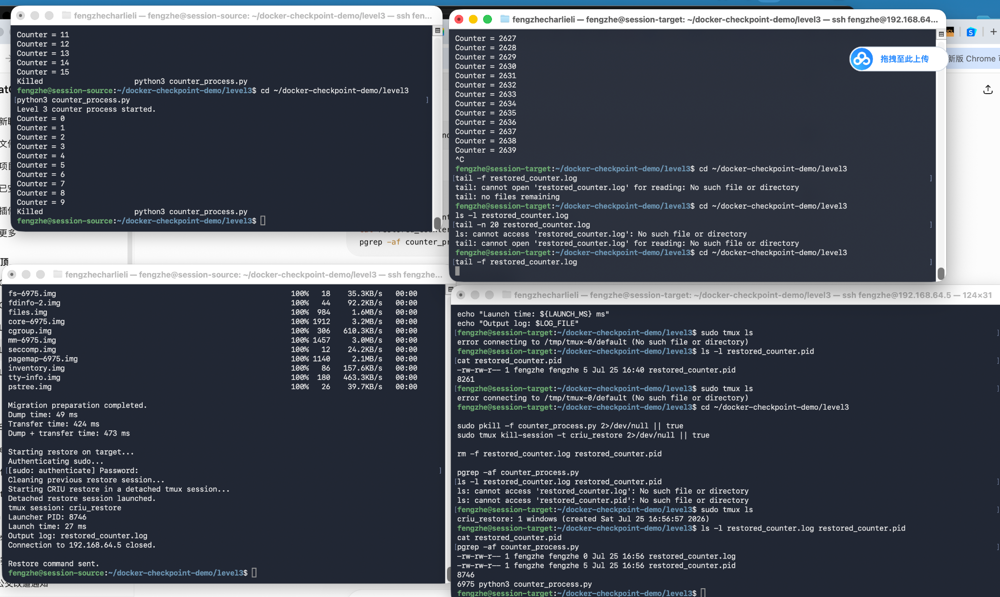

- **Evidence type:** architecture/workflow evidence
- **What it shows:** workflow diagram or terminal workflow evidence.
- **Claim supported:** Supports the Level 3 claim that native CRIU can migrate process state outside Docker.

### Level3 Criu Cross Machine Restore And Counter Continuity

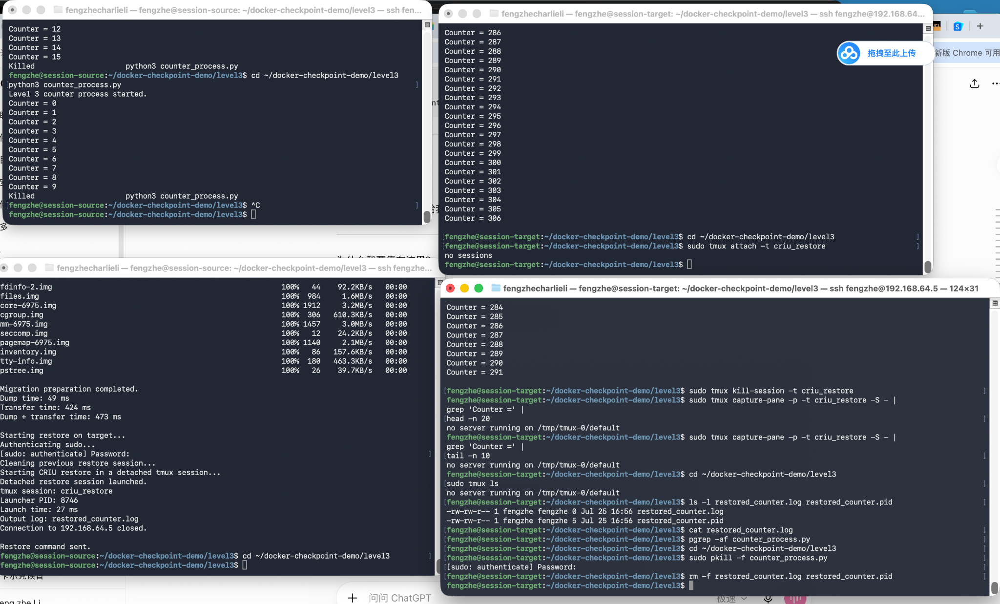

- **Evidence type:** representative migration evidence
- **What it shows:** counter continuity evidence.
- **Claim supported:** Supports the Level 3 claim that native CRIU can migrate process state outside Docker.

### Level3 Criu Cross Machine Restore Counter Continuity

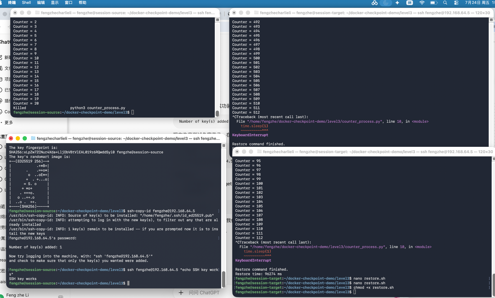

- **Evidence type:** representative migration evidence
- **What it shows:** counter continuity evidence.
- **Claim supported:** Supports the Level 3 claim that native CRIU can migrate process state outside Docker.

### Level3 Criu Cross Machine Restore Debugging Context

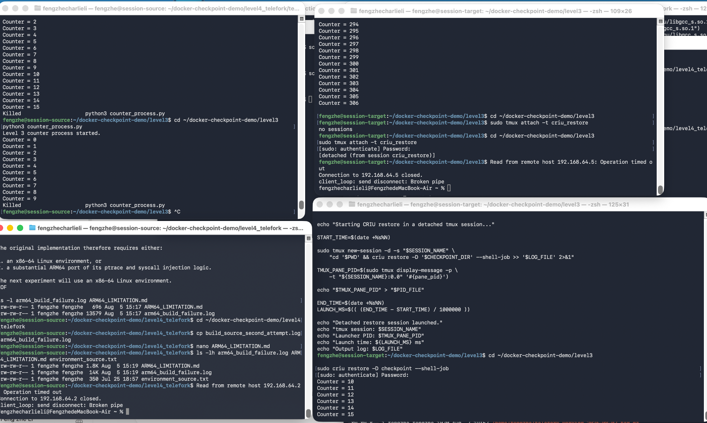

- **Evidence type:** failure/diagnostic evidence
- **What it shows:** restore-side evidence.
- **Claim supported:** Documents diagnostic work and limitations encountered during native CRIU migration.

### Level3 Criu Cross Machine Restore Process Continuity

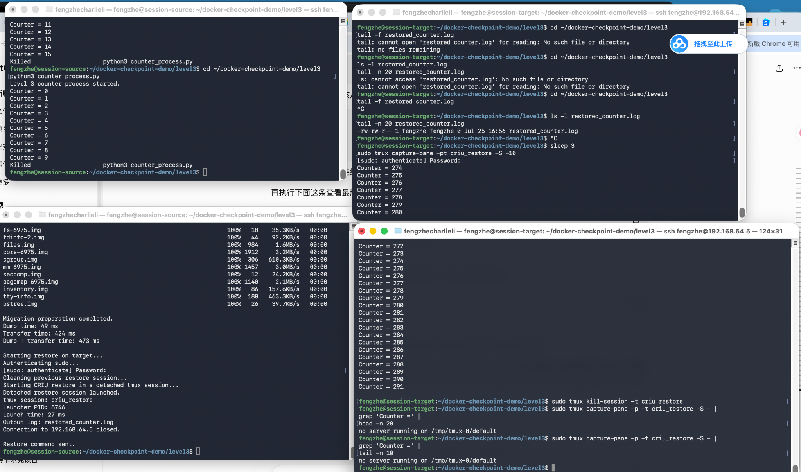

- **Evidence type:** representative migration evidence
- **What it shows:** restore-side evidence.
- **Claim supported:** Supports the Level 3 claim that native CRIU can migrate process state outside Docker.

### Level3 Criu Cross Machine Setup

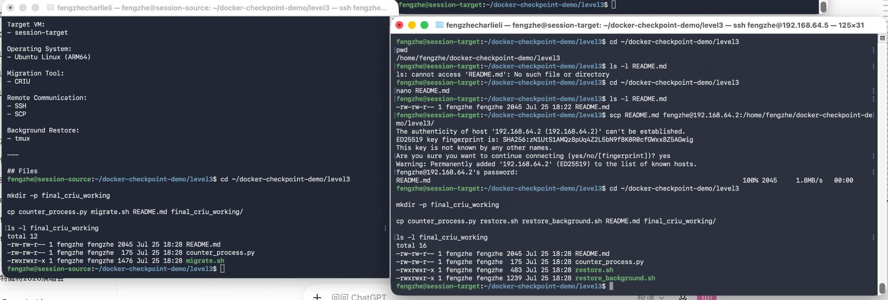

- **Evidence type:** supporting evidence
- **What it shows:** level3 criu cross machine setup.
- **Claim supported:** Supports the Level 3 claim that native CRIU can migrate process state outside Docker.

### Level3 Criu Manual Checkpoint Created

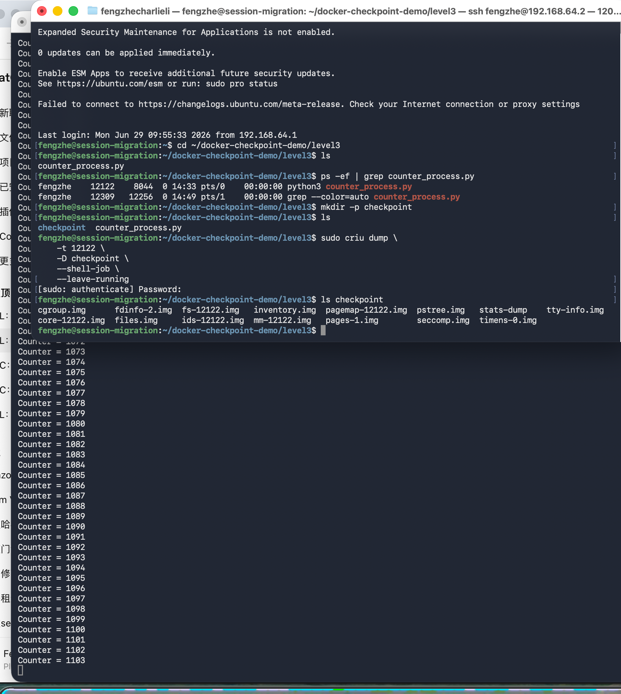

- **Evidence type:** representative migration evidence
- **What it shows:** level3 criu manual checkpoint created.
- **Claim supported:** Supports the Level 3 claim that native CRIU can migrate process state outside Docker.

### Level3 Criu Manual Restore Counter Continuity

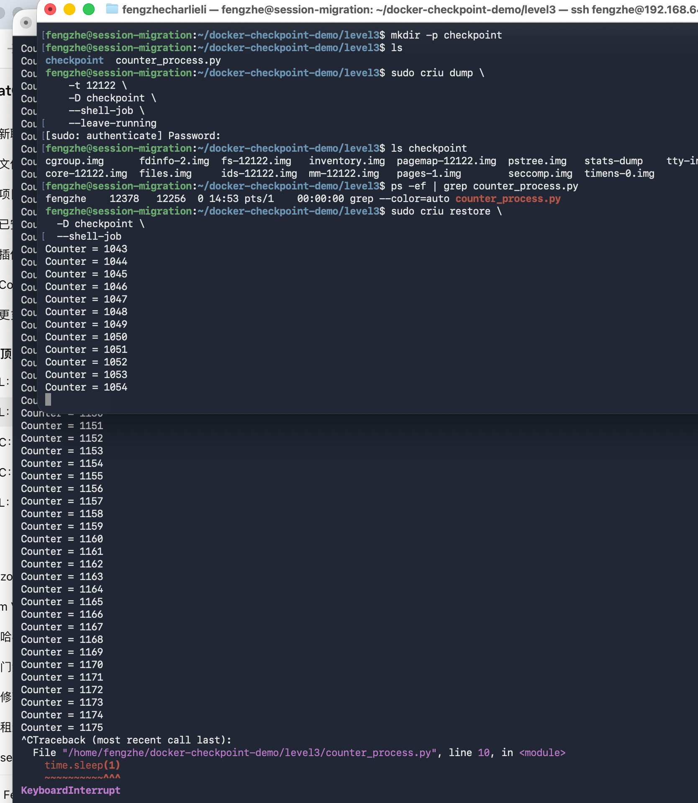

- **Evidence type:** representative migration evidence
- **What it shows:** counter continuity evidence.
- **Claim supported:** Supports the Level 3 claim that native CRIU can migrate process state outside Docker.

### Level3 Criu Restore Script Implementation

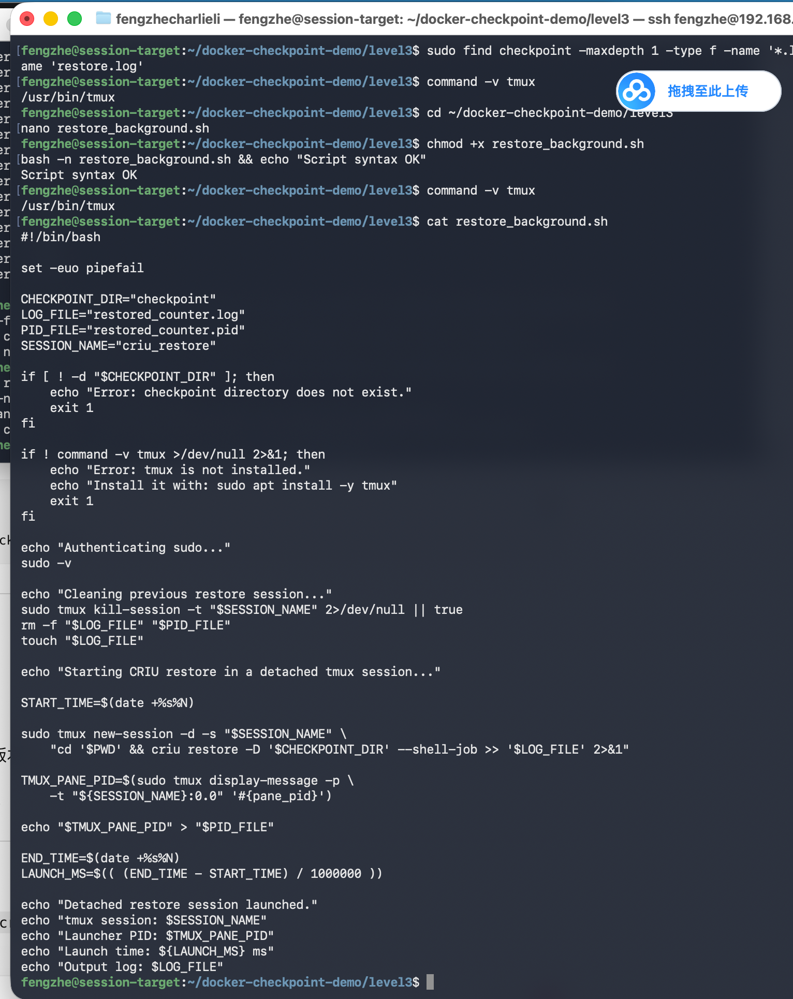

- **Evidence type:** representative migration evidence
- **What it shows:** restore-side evidence.
- **Claim supported:** Supports the Level 3 claim that native CRIU can migrate process state outside Docker.

### Level3 Criu Target Restored Counter Observation

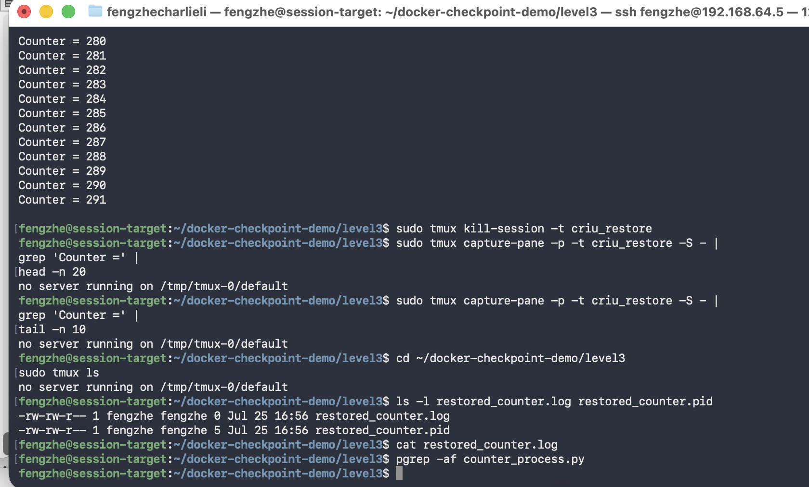

- **Evidence type:** target-side terminal evidence
- **What it shows:** counter continuity evidence.
- **Claim supported:** Supports the Level 3 claim that native CRIU can migrate process state outside Docker.

### Level3 Cross Machine Environment Source Target

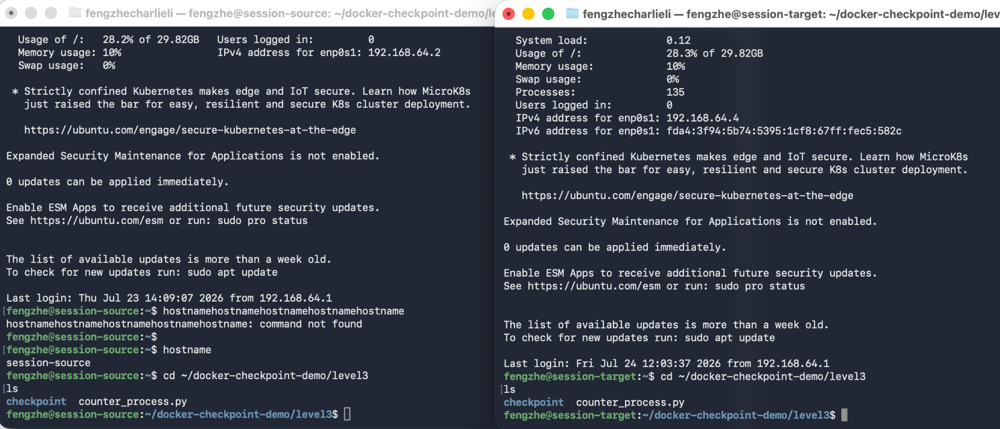

- **Evidence type:** source-side terminal evidence
- **What it shows:** source-side terminal evidence.
- **Claim supported:** Supports the Level 3 claim that native CRIU can migrate process state outside Docker.

### Level3 Native Criu Raw Csv

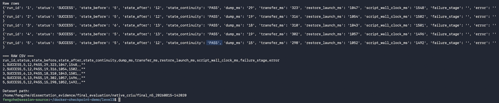

- **Evidence type:** repeated-run evidence
- **What it shows:** raw CSV or per-run result evidence.
- **Claim supported:** Supports final native CRIU repeated-run evaluation.

### Level3 Native Criu Summary

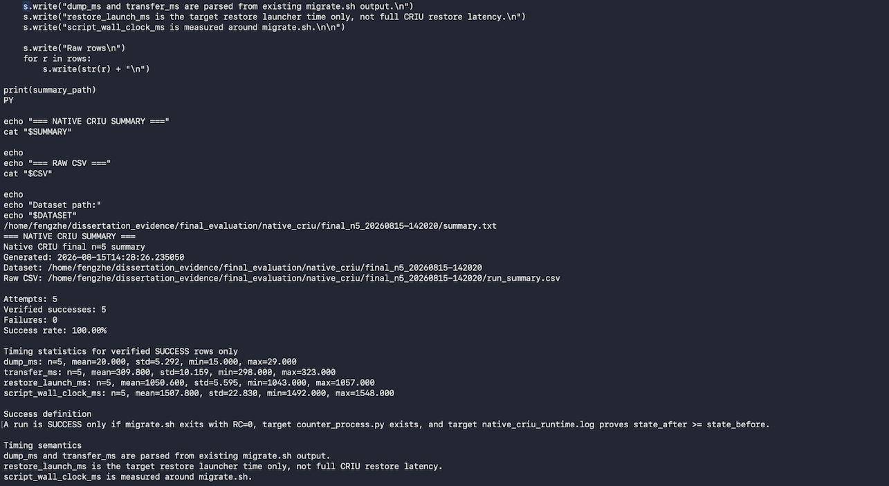

- **Evidence type:** repeated-run evidence
- **What it shows:** native CRIU process migration result.
- **Claim supported:** Supports the Level 3 claim that native CRIU can migrate process state outside Docker.

### Manual Criu Checkpoint Dump Created

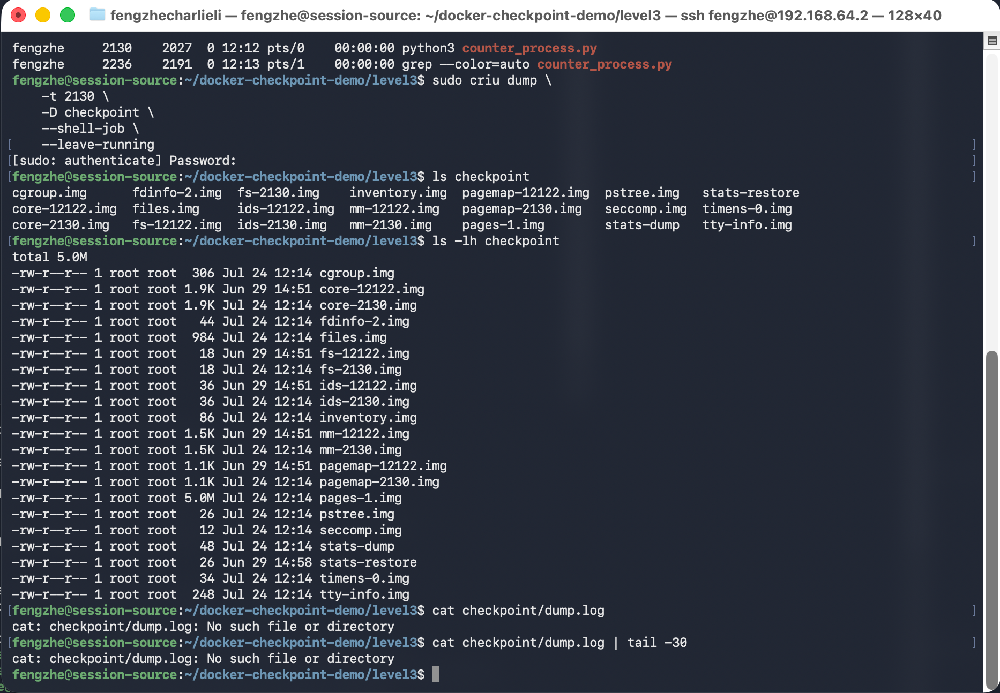

- **Evidence type:** representative migration evidence
- **What it shows:** manual CRIU validation evidence.
- **Claim supported:** Supports the Level 3 claim that native CRIU can migrate process state outside Docker.

### Manual Criu Source Process Running

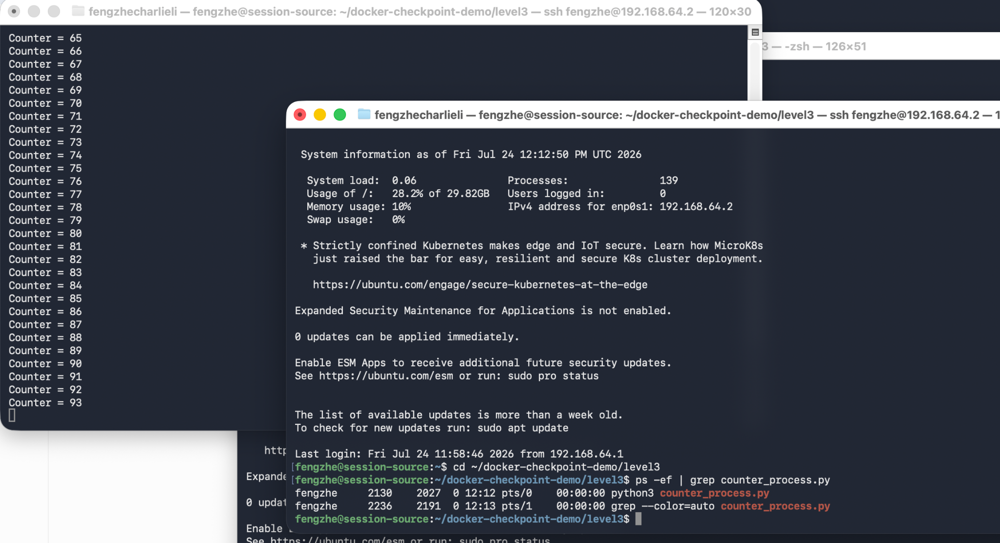

- **Evidence type:** source-side terminal evidence
- **What it shows:** manual CRIU validation evidence.
- **Claim supported:** Supports the Level 3 claim that native CRIU can migrate process state outside Docker.

### Native Criu Cross Machine Continuity Evidence

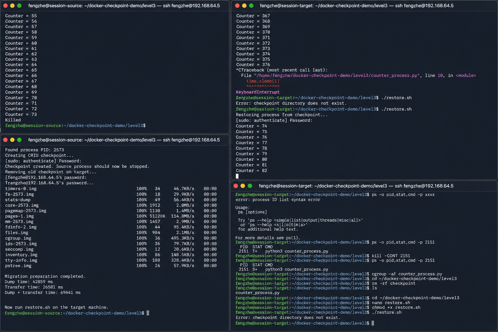

- **Evidence type:** representative migration evidence
- **What it shows:** native CRIU process migration result.
- **Claim supported:** Supports the Level 3 claim that native CRIU can migrate process state outside Docker.

### Native Criu N5 All Success Runs

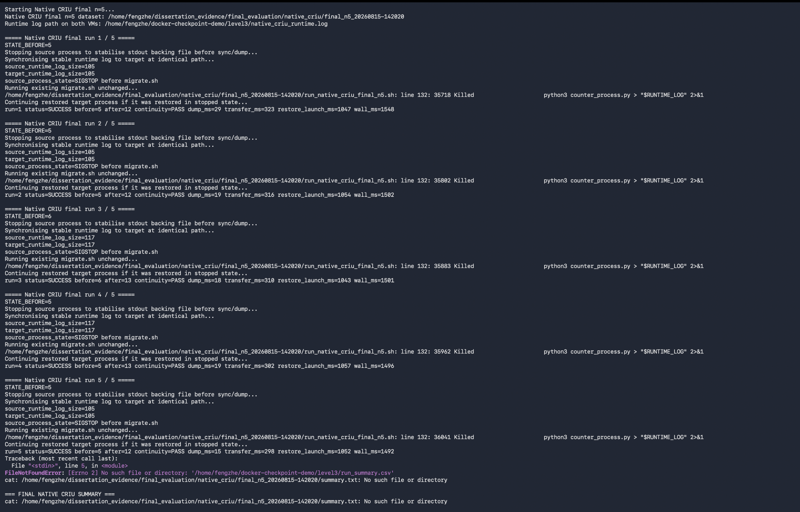

- **Evidence type:** repeated-run evidence
- **What it shows:** native CRIU process migration result.
- **Claim supported:** Supports final native CRIU repeated-run evaluation.

### Native Criu N5 Final Summary And Raw Csv

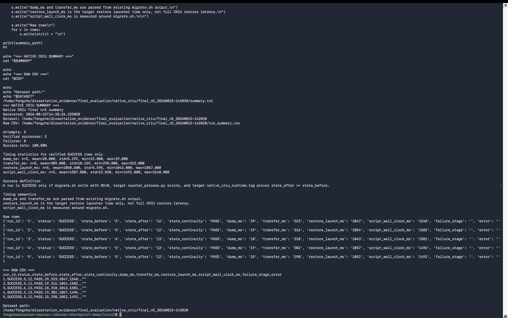

- **Evidence type:** repeated-run evidence
- **What it shows:** raw CSV or per-run result evidence.
- **Claim supported:** Supports final native CRIU repeated-run evaluation.

### Native Criu N5 Raw Csv And Results

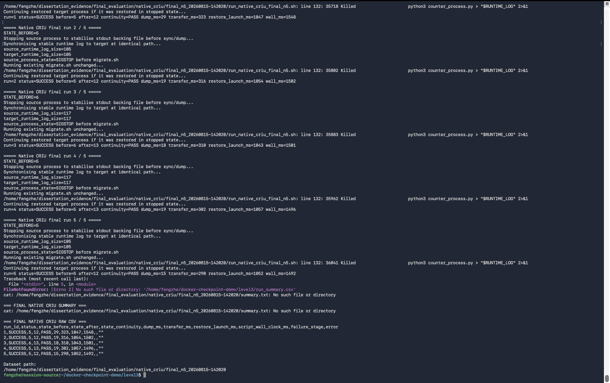

- **Evidence type:** repeated-run evidence
- **What it shows:** raw CSV or per-run result evidence.
- **Claim supported:** Supports final native CRIU repeated-run evaluation.

### Native Criu N5 Timing 2X2

[native_criu_n5_timing_2x2.pdf](../figures/level3-native-criu/native_criu_n5_timing_2x2.pdf)

- **Evidence type:** repeated-run evidence
- **What it shows:** timing breakdown or per-run timing evidence.
- **Claim supported:** Supports final native CRIU repeated-run evaluation.

### Native Criu N5 Timing 2X2

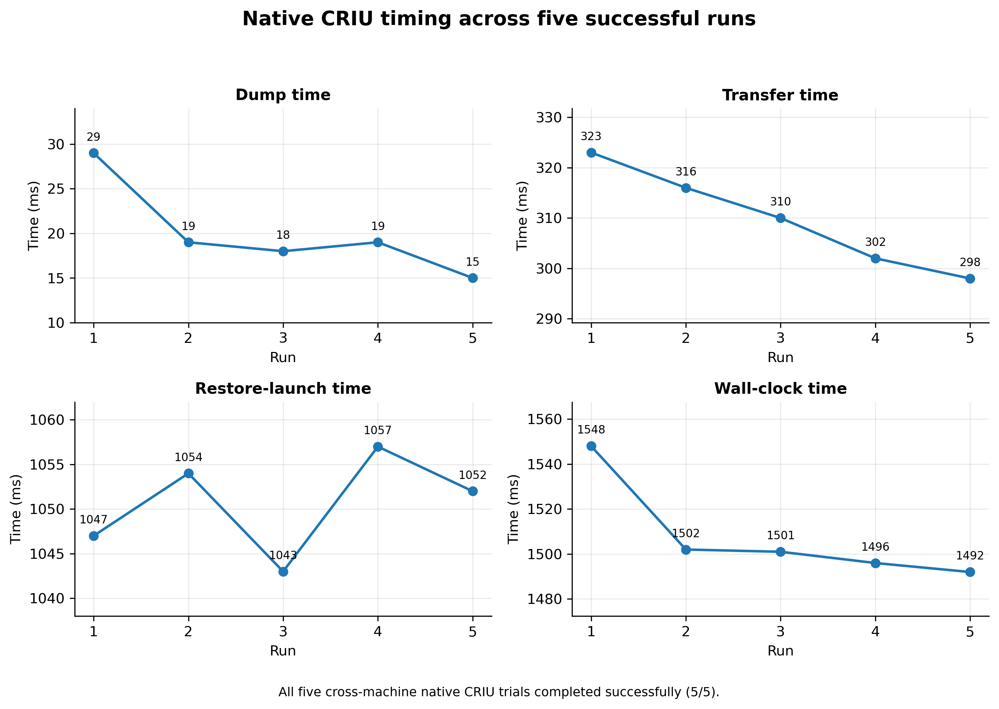

- **Evidence type:** repeated-run evidence
- **What it shows:** timing breakdown or per-run timing evidence.
- **Claim supported:** Supports final native CRIU repeated-run evaluation.

